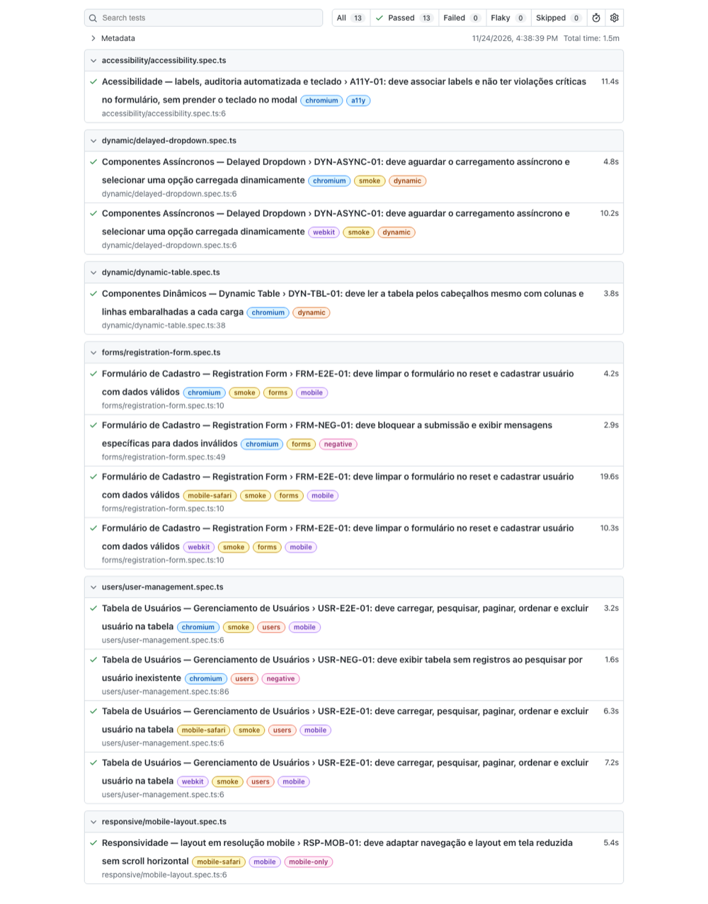
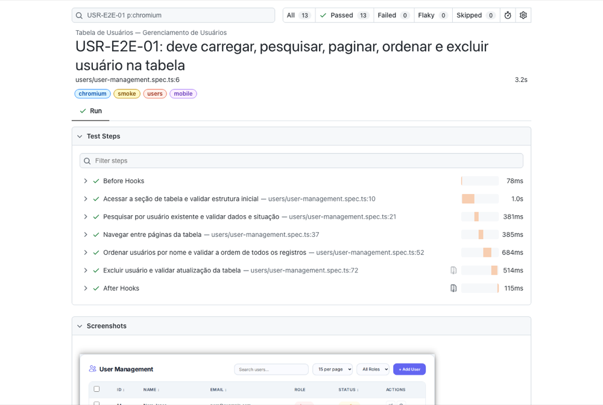
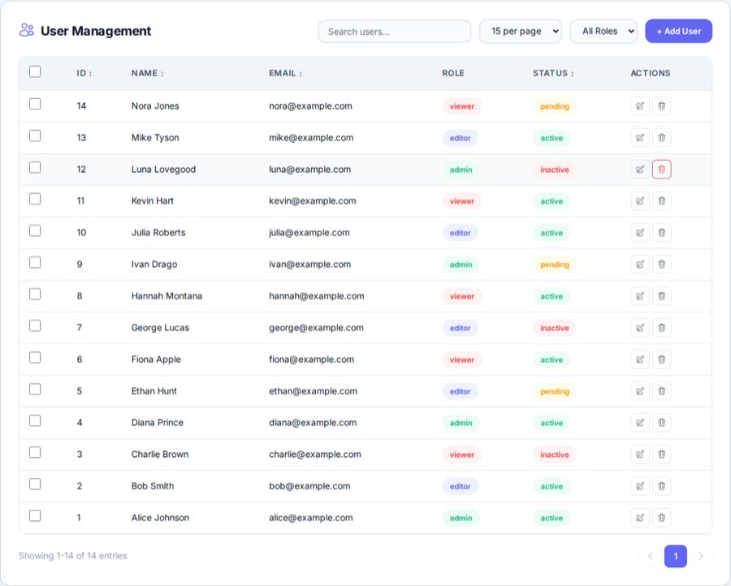
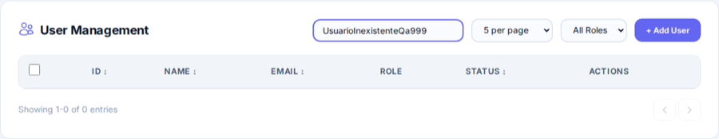
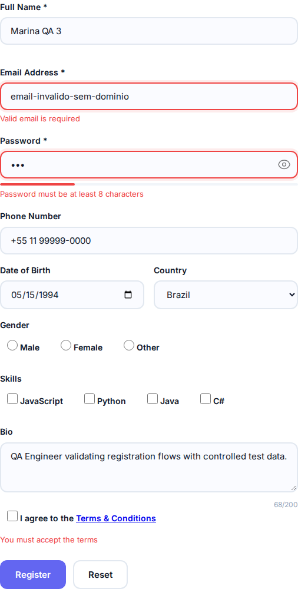
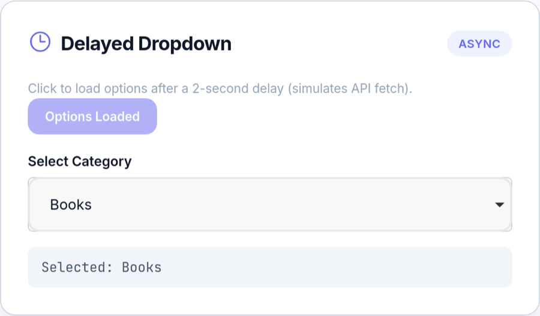
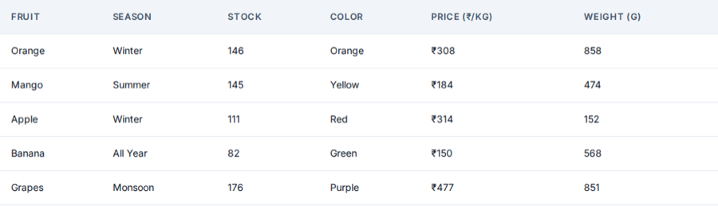
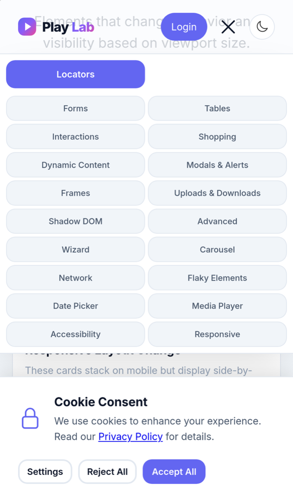
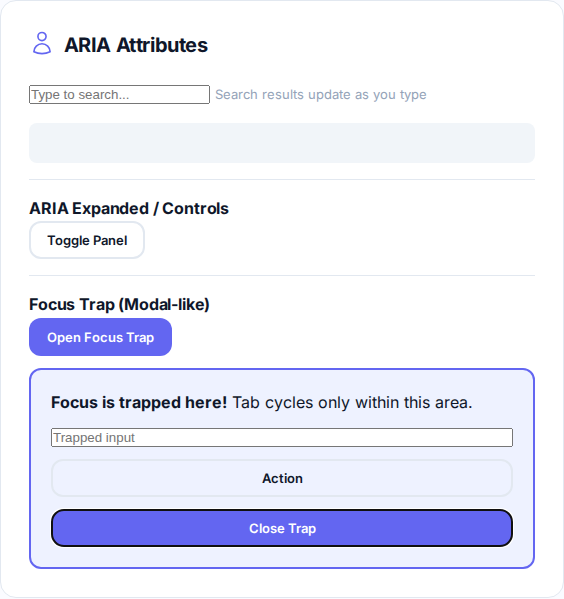

# Case Técnico — Engenharia de Qualidade Front Web (PlayLab)

## 1. Descrição da solução

Este repositório apresenta a suíte de automação Front Web desenvolvida para o **Case Técnico de Engenharia de Qualidade Front Web**, com foco em análise de risco, priorização orientada a valor, arquitetura sustentável, sincronização baseada em estado observável, acessibilidade, responsividade mobile e execução automatizada em CI/CD.

A documentação estratégica completa está em:
- [docs/estrategia-de-testes.md](./docs/estrategia-de-testes.md)
- [docs/matriz-de-riscos.md](./docs/matriz-de-riscos.md)
- [docs/matriz-de-cenarios.md](./docs/matriz-de-cenarios.md)

### Início rápido

Precisa de Node.js 20 ou mais novo e acesso à internet (a aplicação-alvo é o site público do PlayLab).

```bash
npm ci                                  # 1. instala as dependências
npx playwright install chromium webkit  # 2. baixa os navegadores
npm test                                # 3. roda os 8 testes (13 execuções em 3 projetos)
npm run report                          # 4. abre o relatório HTML com passos, prints e logs
```

Para rodar só um teste: `npx playwright test --grep "DYN-ASYNC-01"`. Todos os comandos estão na [seção 7](#7-instruções-de-execução).

### Por que estas escolhas, em resumo

| Escolha | Por quê |
|---|---|
| 8 testes: 5 de núcleo e 3 complementares | O enunciado pede de 5 a 8, escolhidos por risco. Cada item obrigatório tem um teste, e os 3 restantes cobrem riscos que ficariam de fora. O que não foi automatizado está justificado na [matriz de cenários](./docs/matriz-de-cenarios.md) |
| Chromium completo, WebKit só `@smoke`, iPhone 13 só `@mobile` | Cobre dois motores e o mobile sem triplicar o tempo da pipeline nem sobrecarregar o site público |
| Seletores por papel e label; `data-testid` só quando não há nome acessível | Resiste a mudanças de layout. Onde a página não oferece nome acessível, o `data-testid` é um contrato explícito |
| Sem `waitForTimeout`; relógio e sorteio controlados onde decidem o resultado | A espera é por estado observável. Nos dois casos em que o tempo ou o sorteio mudariam o resultado, o teste os controla em vez de torcer para dar certo |
| Acessibilidade: barra só violação crítica, e só no formulário | O site já tem violações. Barrar tudo deixaria a suíte sempre vermelha; ignorar esconderia o problema. A página inteira vai para o relatório como evidência |
| Print em todo teste, trace só em falha | Um relatório verde sem prints não mostra o que foi validado. Trace de tudo pesaria na cota de artefatos |

Os detalhes de cada decisão estão nas seções [3](#3-escopo-implementado) e [15](#15-decisões-técnicas).

---

## 2. Aplicação utilizada

- **PlayLab — Playwright Practice Arena:** [https://playwrightlab.github.io/](https://playwrightlab.github.io/)

---

## 3. Escopo implementado

A suíte tem **8 testes** (dentro da faixa de 5 a 8 exigida), todos passando em `chromium`, `webkit` e `mobile-safari` — **13 execuções** no total, conforme a estratégia de navegadores da seção 8.

### Por que estes 8

O enunciado pede os cenários principais, não todos. A escolha seguiu três filtros (detalhados na [estratégia, seção 5](./docs/estrategia-de-testes.md#5-estratégia-de-cobertura)):

1. **Núcleo (5 testes):** um teste para cada item obrigatório do enunciado — jornada da tabela, formulário, cenário negativo, componente assíncrono e acessibilidade —, escolhendo em cada categoria o cenário de maior risco. A execução mobile obrigatória não exigiu teste novo: as jornadas P0 rodam também no iPhone 13.
2. **Complementares (3 testes):** as vagas restantes da faixa foram para riscos que o núcleo não pega — estado vazio da busca (onde há um defeito real), tabela com colunas que mudam de posição e layout mobile. São os primeiros a sair se a suíte precisar diminuir.
3. **Fora:** cada cenário de referência do enunciado tem a decisão registrada na [matriz de cenários](./docs/matriz-de-cenarios.md#2-rastreabilidade-dos-cenários-de-referência-do-enunciado) — qual teste o cobre ou por que não foi automatizado.

Dentro de cada teste, só o comportamento principal é validado (um usuário na busca, uma coluna na ordenação, um cadastro válido e duas combinações inválidas no formulário); variações exaustivas de regra pertencem a testes unitários ou de componente.

| ID | O que valida | Grupo | Prioridade | Referências do enunciado | Tags | Arquivo |
|---|---|---|---|---|---|---|
| `USR-E2E-01` | Jornada da tabela: carga, busca, paginação, ordenação e exclusão | Núcleo | P0 | USR-01, 02, 03, 05, 06, 07, 08 · RSP-01, 02 | `@smoke`, `@users`, `@mobile` | `tests/users/user-management.spec.ts` |
| `FRM-E2E-01` | Reset e cadastro válido | Núcleo | P0 | FRM-01, 05 · RSP-01, 02 | `@smoke`, `@forms`, `@mobile` | `tests/forms/registration-form.spec.ts` |
| `FRM-NEG-01` | Obrigatórios, e-mail e senha inválidos | Núcleo | P0 | FRM-02, 03, 06 | `@forms`, `@negative` | `tests/forms/registration-form.spec.ts` |
| `DYN-ASYNC-01` | Dropdown com carga assíncrona | Núcleo | P0 | DYN-01, 02, 06, 07 · RSP-01 | `@smoke`, `@dynamic` | `tests/dynamic/delayed-dropdown.spec.ts` |
| `A11Y-01` | Labels, axe-core e diálogo por teclado | Núcleo | P1 | A11Y-02, 03, 04, 06, 07 · FRM-07 | `@a11y` | `tests/accessibility/accessibility.spec.ts` |
| `USR-NEG-01` | Busca sem resultado | Complementar | P1 | USR-04 | `@users`, `@negative` | `tests/users/user-management.spec.ts` |
| `DYN-TBL-01` | Tabela com colunas e linhas embaralhadas | Complementar | P1 | DYN-03, 04, 05 | `@dynamic` | `tests/dynamic/dynamic-table.spec.ts` |
| `RSP-MOB-01` | Layout e ações em tela de celular | Complementar | P1 | RSP-03, 04, 05 | `@mobile`, `@mobile-only` | `tests/responsive/mobile-layout.spec.ts` |

---

## 4. Stack utilizada

- **Playwright Test** (`@playwright/test`)
- **TypeScript** (modo `strict`)
- **Node.js** (v24 LTS no CI / >= 20 local)
- **`@axe-core/playwright`** (auditoria automatizada WCAG 2.0/2.1 A e AA; regras *best-practice* só como evidência)
- **`dotenv`** (configuração centralizada via variáveis de ambiente)
- **GitHub Actions** (CI/CD com matriz de projetos e artefatos)

---

## 5. Pré-requisitos

- **Node.js** >= 20 LTS
- **npm** >= 10
- Acesso de rede a `https://playwrightlab.github.io/`

---

## 6. Instruções de instalação

```bash
# 1. Instalar dependências do projeto
npm ci

# 2. Instalar os navegadores configurados na estratégia (Chromium e WebKit)
npx playwright install chromium webkit

# 3. (Opcional) Configurar variáveis locais a partir do exemplo
cp .env.example .env
```

---

## 7. Instruções de execução

```bash
# Validar tipagem estrita TypeScript
npm run typecheck

# Executar toda a estratégia configurada (Chromium + WebKit @smoke + Mobile Safari @mobile)
npm test

# Executar com navegador visível ou UI interativa do Playwright
npm run test:headed
npm run test:ui

# Executar seletivamente por tag / domínio
npm run test:smoke
npm run test:users
npm run test:forms
npm run test:dynamic
npm run test:a11y
npm run test:negative
npm run test:responsive   # apenas o cenário de layout mobile (@mobile-only no projeto mobile-safari)

# Executar um único teste pelo ID
npx playwright test --grep "DYN-ASYNC-01"
```

---

## 8. Execução por navegador

A estratégia multi-browser combina **Chromium** (suíte completa) e **WebKit** (fluxos críticos `@smoke`), equilibrando cobertura cross-engine com tempo enxuto de pipeline:

```bash
# Suíte desktop completa no Chromium (1280x720)
npm run test:chromium

# Subconjunto crítico @smoke no WebKit / Desktop Safari (1280x720)
npm run test:webkit
```

---

## 9. Execução mobile

O projeto `mobile-safari` utiliza o perfil `iPhone 13` (`390×844`, motor WebKit mobile com suporte a toque) e executa todos os cenários marcados com `@mobile`:

```bash
npm run test:mobile
```

---

## 10. Relatório e evidências

Toda execução gera um **relatório HTML** (`playwright-report/`). Em cada teste, o relatório mostra:

| Evidência | Quando | Onde é configurada |
|---|---|---|
| Passos do teste (`test.step`) com o tempo de cada um | Sempre | Specs |
| **Print do estado validado** (ex.: `evidencia-tabela-apos-exclusao`, `evidencia-cadastro-sucesso`, `evidencia-menu-mobile-aberto`) | Sempre, logo depois das asserções do passo. Se o print do componente não sair em 3 s, registra a tela visível com uma nota: a evidência nunca reprova o teste. No print de componente, a barra de navegação e o banner de cookies (fixos) são ocultados, porque apareceriam fora do lugar, no meio da imagem | `src/utils/evidence.ts` |
| Screenshot do fim do teste | Sempre | `playwright.config.ts` (`screenshot: 'on'`) |
| **Logs do navegador** (`browser-logs.txt`): erros de console, exceções da página, requisições com falha e respostas HTTP ≥ 400 | Sempre (registra também quando não houve erro) | Fixture automática `browserLogs` em `src/fixtures/test.fixtures.ts` |
| Auditorias axe-core (`axe-registration-form.json`, `axe-full-page.json`) e anotação com as violações conhecidas | `A11Y-01` | `src/utils/a11y.helper.ts` |
| Trace (linha do tempo com DOM, rede e console de cada ação) | Em falha, incluindo a tentativa que falhou de um teste instável. Com `PW_TRACE=on` (ou o input `trace` do disparo manual), de todos os testes | `playwright.config.ts` |
| Vídeo | Só na nova tentativa (retry) de um teste que falhou | `playwright.config.ts` |

Para abrir o relatório HTML localmente:

```bash
npm run report
```

Para inspecionar um trace salvo após falha (ou qualquer trace, pelo próprio relatório):

```bash
npx playwright show-trace test-results/<pasta-do-teste>/trace.zip
```

### Pipeline (GitHub Actions)

O workflow [`.github/workflows/tests.yml`](./.github/workflows/tests.yml) roda em `push`/`pull_request` na `main` e manualmente (`workflow_dispatch`), com quatro jobs:

1. **`plan`** — monta a matriz de projetos a partir do input manual (`all`, `chromium`, `webkit` ou `mobile-safari`). A matriz é calculada num job próprio porque o GitHub não permite usar o contexto `matrix` no `if` de um job.
2. **`typecheck`** — `tsc --noEmit` como gate antes dos testes.
3. **`e2e-tests`** — um job por projeto, em paralelo (`fail-fast: false`), com cache de dependências npm e dos navegadores Playwright, e filtro opcional por tag.
4. **`merge-reports`** — junta os relatórios `blob` de todos os projetos em um único HTML (`playwright-report-merged`) e publica um resumo (passaram, falharam, flaky) na página da execução.

No disparo manual há três opções: navegador, tag e trace (`retain-on-failure`, o padrão, ou `on` para gravar o trace de todos os testes).

Artefatos publicados em cada execução:

- **`playwright-report-merged`** — relatório HTML único dos 3 projetos, com todas as evidências da tabela acima (retenção de 30 dias). Para abrir: baixar, descompactar e rodar `npx playwright show-report <pasta>`.
- **`test-results-<projeto>`** — só quando há falha: arquivos brutos de trace, vídeo e screenshot, para abrir direto com `show-trace` (30 dias).
- **Resumo da execução** na página do run (passaram, falharam, instáveis, ignorados).

O relatório consolidado é publicado mesmo quando há falha (`if: !cancelled()`). Não há um relatório HTML por projeto: ele repetiria o consolidado e multiplicaria o espaço de armazenamento usado.

### Exemplos de evidência

Prints tirados do relatório consolidado de uma execução real da pipeline (13 de 13 aprovados, nenhum instável). Ficam versionados em [`docs/evidencias/`](./docs/evidencias/) para não depender da validade do artefato.

Depois dessa execução, os testes `DYN-ASYNC-01` e `DYN-TBL-01` passaram a controlar o relógio e o sorteio (seção 13), e o título do `DYN-TBL-01` mudou. A execução mais recente, com 13 de 13 aprovados e nenhum instável, é a [45702547534](https://github.com/felipecassinrosa/front-web-qa-challenge/actions/runs/45702547534).

**Relatório consolidado** — os 8 testes nos 3 projetos, com as tags de cada um:



**Detalhe de um teste** — passos do `USR-E2E-01` com o tempo de cada um:



**Print do estado validado, um por teste:**

<table>
<tr>
<td width="50%"><b>USR-E2E-01</b> — tabela depois de excluir o Oscar Wilde: 14 registros, ordem decrescente<br></td>
<td width="50%"><b>USR-NEG-01</b> — busca sem resultado: nenhuma linha e o contador <code>Showing 1-0 of 0 entries</code> (defeito RSK-U01)<br></td>
</tr>
<tr>
<td><b>FRM-E2E-01</b> — mensagem de sucesso após o cadastro<br></td>
<td rowspan="2"><b>FRM-NEG-01</b> — e-mail e senha inválidos e termos desmarcados: só o erro do nome (corrigido) sumiu<br></td>
</tr>
<tr>
<td><b>DYN-ASYNC-01</b> (WebKit) — opção carregada após o atraso e selecionada; o botão segue desabilitado<br></td>
</tr>
<tr>
<td><b>DYN-TBL-01</b> — tabela dinâmica depois do reload, lida pelos cabeçalhos<br></td>
<td rowspan="2"><b>RSP-MOB-01</b> (iPhone 13) — menu hambúrguer aberto; o banner de cookies (RSK-U04) cobre a parte de baixo da tela<br></td>
</tr>
<tr>
<td><b>A11Y-01</b> — diálogo aberto só pelo teclado, com o foco no botão <i>Close Trap</i><br></td>
</tr>
</table>

---

## 11. Arquitetura do projeto

```text
front-web-qa-challenge/
├── .github/workflows/
│   └── tests.yml                # Pipeline GitHub Actions (typecheck + matriz + filtros manuais)
├── docs/
│   ├── estrategia-de-testes.md  # Estratégia completa e critérios de cobertura
│   ├── matriz-de-riscos.md      # Riscos funcionais, técnicos, UX, a11y e achados reais
│   ├── matriz-de-cenarios.md    # Cenários priorizados e rastreabilidade do enunciado
│   └── evidencias/              # Prints de uma execução real do CI (relatório e estado validado)
├── src/
│   ├── data/
│   │   └── userData.factory.ts  # Factories e constantes de massa fictícia controlada
│   ├── fixtures/
│   │   └── test.fixtures.ts     # Page Objects injetados nos testes + fixture automática de logs do navegador
│   ├── pages/
│   │   ├── BasePage.ts
│   │   ├── UsersTablePage.ts
│   │   ├── RegistrationFormPage.ts
│   │   ├── DynamicComponentsPage.ts
│   │   ├── AccessibilityPage.ts
│   │   └── ResponsivePage.ts
│   └── utils/
│       ├── a11y.helper.ts       # Wrapper do axe-core com anexo automático no relatório HTML
│       └── evidence.ts          # Anexa ao relatório o print do estado validado
├── tests/
│   ├── users/                   # Jornada principal e cenário negativo da Tabela de Usuários
│   ├── forms/                   # Registration Form: caminho feliz com reset e validações negativas
│   ├── dynamic/                 # Delayed Dropdown (assíncrono) e Dynamic Table (embaralhada)
│   ├── accessibility/           # Teclado, foco, labels e auditoria axe-core
│   └── responsive/              # Layout e navegação em resolução mobile
├── .env.example
├── .gitignore
├── package.json
├── playwright.config.ts
├── tsconfig.json
└── README.md
```

**Separação de responsabilidades:**
- **`src/pages/`:** encapsula seletores e ações orientadas à intenção do negócio, mantendo as asserções visíveis nos arquivos `*.spec.ts`.
- **`src/fixtures/`:** injeta Page Objects via `test.extend`, eliminando boilerplate de instanciação repetitiva.
- **`src/data/`:** centraliza factories de dados fictícios e sementes conhecidas, evitando acoplamento a dados reais ou estado compartilhado.
- **`src/utils/`:** concentra utilitários transversais (auditoria `axe-core` e prints de evidência).

---

## 12. Estratégia de seletores

Hierarquia adotada para maximizar resiliência e aproximar o teste do comportamento real do usuário:

1. **Prioridade 1 — Seletores semânticos:** `getByRole`, `getByLabel`, `getByPlaceholder`, `getByText` (ex.: campos do Registration Form, menu hambúrguer `Toggle menu`, botões do Focus Trap). Os labels do formulário usam regex ancorada (`/^Password/`) porque `/Password/i` também casaria com o botão `Toggle password visibility` e causaria *strict mode violation*.
2. **Prioridade 2 — Contrato explícito (`getByTestId`):** usado quando o componente não possui nome acessível confiável (ex.: o seletor de linhas por página `#rowsPerPage` e os botões de ação da Tabela de Usuários, cuja falta de label foi identificada como defeito crítico de acessibilidade na auditoria `axe-core`).
3. **Proibido no projeto:** XPath absoluto, seletores acoplados a classes puramente visuais e índices posicionais fixos (`nth-child`). Na leitura de colunas de tabelas, o índice é resolvido dinamicamente a partir do texto do cabeçalho (`<thead>`), tanto na Tabela de Usuários (`getCell(row, 'Status')`) quanto na Dynamic Table.

---

## 13. Estratégia de sincronização

- Uso exclusivo de **auto-waiting** do Playwright e **web-first assertions** (`toBeVisible`, `toBeEnabled`, `toBeHidden`, `toHaveCount`, `toContainText`).
- **Zero `waitForTimeout`:** fluxos assíncronos (como o *Delayed Dropdown* de 2s) sincronizam pela transição de estados observáveis (exibição/ocultação do loader e habilitação do `<select>`).
- **Leituras em lote só depois de um estado confirmado:** antes de ler uma coluna inteira (`getColumnValues`, `readDynamicTableRecords`), o teste espera a contagem de linhas com `toHaveCount`, para não ler a tabela no meio de uma atualização.
- **Tempo e sorteio controlados só onde importa:**
  - `DYN-ASYNC-01`: o relógio da página fica congelado (`page.clock`) e o teste o avança. O estado "carregando" não depende da velocidade da máquina. Só `clock.install()` não basta: sem `pauseAt` o tempo continua correndo (medido: o loader sumia sozinho em 3 s).
  - `DYN-TBL-01`: o `Math.random` é fixado antes da página carregar, e o teste compara duas cargas com layouts de fato diferentes, em vez de torcer para o sorteio mudar a ordem. Ele valida as regras que não mudam: fruta → cor/estação e faixas numéricas.
  - Nos dois, a espera continua sendo por estado observável. Nenhum `waitForTimeout`.
- **Verificação de estabilidade:** a suíte foi executada com `--repeat-each=5` nos 3 projetos (65/65 aprovados) antes da entrega.
- **Instabilidade real encontrada no CI e corrigida:** o `FRM-E2E-01` falhou na 1ª tentativa no WebKit (desktop e iPhone) em 3 de 4 execuções e passou no retry. A investigação usou os traces das tentativas que falharam e as durações registradas no relatório:
  - as ações que exigem elemento estável (`check`, `click`, print de elemento) levavam de 2 a 7 s; os `fill`, menos de 0,3 s;
  - a hipótese de o banner de cookies cobrir os botões foi testada e descartada: os logs não mostram nenhuma nova tentativa por elemento coberto;
  - o mesmo teste levava de 27 a 40 s na 1ª tentativa e ~14 s no retry, que roda quase sozinho. A causa era disputa de CPU: 2 workers WebKit gravando vídeo e screencast num runner de 2 vCPUs (o repositório era privado na época, confirmado no log do job; runners de repositório público costumam ter mais CPU).

  Correções: 1 worker por job no CI (o paralelismo já acontece entre os jobs de cada navegador), vídeo só no retry e evidência com tempo-limite próprio, que nunca reprova o teste. Na execução seguinte, os 13 testes passaram de primeira, com o `FRM-E2E-01` em ~13 s no WebKit.
- Timeouts globais configurados centralmente em `playwright.config.ts` (`timeout: 30s`, `expect: 10s`, `actionTimeout: 10s`). No CI, os projetos WebKit têm 45 s por teste: lá o WebKit é de 2 a 3 vezes mais lento que o Chromium (até 19,6 s no `FRM-E2E-01` do iPhone, contra ~4 s no Chromium). Os limites de ação e de asserção não mudam, então um travamento real continua sendo pego.

---

## 14. Estratégia de dados de teste

- Todos os dados utilizados nos testes são **fictícios, sintéticos e seguros** (`@example.com`, números fictícios). O formulário usa `buildValidRegistrationUser()` em `src/data/userData.factory.ts`, que gera e-mail com sufixo único por invocação e aceita `overrides` para os cenários negativos (ex.: só o e-mail inválido).
- Dados de referência da aplicação (usuários semente da tabela, opções do dropdown, mensagens de validação e regras da Dynamic Table) ficam centralizados no mesmo módulo, e não espalhados pelos specs.
- Cada teste executa em um `BrowserContext` isolado e independente de ordem (`fullyParallel: true`), sem compartilhamento de estado mutável.
- Nenhuma credencial, token ou dado sensível é versionado no repositório.

---

## 15. Decisões técnicas

- **Playwright + TypeScript:** escolhido por oferecer auto-waiting nativo, execução multi-engine (Chromium/WebKit) sem drivers externos, Trace Viewer rico para diagnóstico e tipagem estrita.
- **Chromium completo + WebKit `@smoke` + Mobile Safari `@mobile`:** trade-off consciente que entrega validação cross-engine e mobile iOS mantendo o tempo de CI enxuto e respeitando a restrição de não sobrecarregar a aplicação com paralelismo excessivo (1 worker por job no CI; os 3 navegadores rodam em jobs paralelos).
- **Seleção dos cenários:** 5 testes de núcleo (um por item obrigatório do enunciado) e 3 complementares para os maiores riscos restantes — ver a seção 3.
- **O que não automatizar em E2E:** combinações exaustivas de regras de campo (melhor cobertas em testes unitários/componente), regras garantidas pelo próprio HTML (`disabled`, `maxlength`), chamadas reais a APIs de terceiros sem mock (`jsonplaceholder`), seções secundárias fora do domínio administrativo (Shopping, Media, Carousel) e validações manuais de tecnologia assistiva.
- **Gate de acessibilidade só em violação crítica, e só no formulário:** a aplicação já tem violações na tabela e no contraste. Barrar tudo deixaria a suíte sempre vermelha; ignorar esconderia os problemas. A auditoria da página inteira vai para o relatório como evidência.
- **Evidência mesmo quando o teste passa:** um relatório verde sem prints não mostra o que foi validado. Cada teste anexa o estado final. O trace fica só para falhas por padrão: com trace de todos os testes, cada execução gerava ~36 MB de artefato, o que pesaria na cota de armazenamento de artefatos. O disparo manual com `trace: on` grava de todos (útil para explicar um trace na apresentação).

---

## 16. Limitações conhecidas

- **Sem persistência backend:** o PlayLab mantém mutações da tabela apenas em memória; recarregar a página restaura os 15 usuários originais.
- **Defeitos reais observados na aplicação-alvo (documentados em `docs/matriz-de-riscos.md`):**
  - Busca por usuário inexistente renderiza tabela vazia sem empty state e exibe `"Showing 1-0 of 0 entries"` (`RSK-U01`).
  - Campo `Bio` não bloqueia entrada acima do limite de 200 caracteres (`210/200` submete com sucesso — `RSK-F06`).
  - Exclusão de usuário na tabela ocorre imediatamente sem diálogo de confirmação (`RSK-F07`).
  - Violações críticas de acessibilidade detectadas pelo `axe-core` na tabela de usuários (`select-name`, `label`, `button-name`) e violação séria `label-content-name-mismatch` na seção `#a11y`.
  - O container com scroll horizontal da tabela não é focável por teclado (`scrollable-region-focusable`), e o menu hambúrguer não expõe `aria-expanded` ao abrir/fechar (`RSK-A07`, `RSK-A08`).
  - O banner de cookies fica fixo na parte de baixo da tela e ocupa 25% da altura no iPhone 13 (163 de 664 px), cobrindo conteúdo e ações até ser fechado (`RSK-U04`).
- **Limitações da análise automatizada de acessibilidade (`axe-core`):** cobre estruturalmente regras detectáveis no DOM (~30–50% dos critérios WCAG), mas **não substitui** testes manuais com leitores de tela (VoiceOver/NVDA), verificação de clareza semântica, zoom 200% e operação assistiva por voz.
  - Exemplo concreto, comprovado por mutação: removendo o `for` do label de e-mail, o axe **não acusou nada**, porque aceita o `placeholder` do campo como nome acessível. Por isso o `A11Y-01` verifica a associação de labels explicitamente.

---

## 17. Uso de Inteligência Artificial

Em conformidade com a transparência solicitada no desafio:

- **Ferramentas utilizadas:**
  - **Antigravity** (assistente de engenharia com modelo Gemini) na etapa inicial: estruturação do repositório, inspeção exploratória do DOM/acessibilidade da aplicação-alvo e escrita da fundação de código e documentação.
  - **Claude Code** (Anthropic) na etapa de revisão: revisão do projeto contra o enunciado do case, correção dos defeitos encontrados e implementação dos 6 cenários restantes.
- **Atividades apoiadas:** bootstrap da configuração Playwright + TypeScript 7, roteiro de exploração técnica do PlayLab, redação inicial das matrizes/estratégia, scaffolding dos Page Objects/Fixtures/CI, especificação da Tabela de Usuários, revisão crítica da suíte e implementação dos cenários de formulário, dinâmicos, acessibilidade e responsividade.
- **Revisão e validação:** cada seletor e comportamento foi verificado em execução real contra `https://playwrightlab.github.io/` (inspeção com scripts Playwright e leitura do `app.js` público da aplicação para entender as regras da Dynamic Table e da ordenação), com `tsc --noEmit`, execução nos 3 projetos e `--repeat-each=3` para detectar instabilidade. Também foram feitos **testes de mutação manuais**: alterar um dado esperado (ex.: status `inactive`, cor da maçã) e confirmar que o teste falha.
- **Erros da IA identificados e corrigidos na revisão:**
  - A asserção de ordenação ASC era um **falso positivo**: a página 1 já vem em ordem alfabética, então o teste passava mesmo sem ordenação. Passou a validar a transição ASC → DESC e a ordem dos 15 registros.
  - A situação do usuário era validada com `toContainText('active')` na linha inteira, o que aceitaria `inactive`. Passou a usar a célula da coluna com `toHaveText` exato.
  - O seletor `getByLabel(/Password/i)` encontrava 2 elementos (campo + botão `Toggle password visibility`). Ainda não havia teste usando o seletor, então o erro passou despercebido — esta seção afirmava antes que "todos os seletores foram comprovados", o que não era verdade.
  - O workflow usava `matrix` no `if` de um job, o que o GitHub Actions não permite; a matriz passou a ser montada num job `plan`.
  - A documentação descrevia como "Coberto" cenários que ainda não existiam.
  - Ao enxugar o `A11Y-01`, a IA propôs remover a checagem manual de labels por considerá-la redundante com o axe. O teste de mutação (remover o `for` de um label) mostrou que o axe não detecta o problema quando o campo tem placeholder; a checagem foi mantida.
  - A configuração inicial só gerava screenshot e trace em falha: uma execução verde não deixava evidência visual do que foi validado. Passou a anexar um print do estado final em todo teste.
  - A primeira versão desse helper de evidência podia reprovar o teste, e o primeiro diagnóstico do flaky que apareceu no CI ficou incompleto: corrigir só o print não resolveu, e o teste voltou a falhar por tempo esgotado. A causa real (disputa de CPU no runner) só apareceu medindo a duração de cada tentativa no relatório. A hipótese do banner de cookies também foi levantada e descartada pelos logs (seção 13).
- **Outros ajustes:** durante o setup inicial, o TypeScript 7 rejeitou opções legadas (`moduleResolution: "Node"` e `baseUrl`), exigindo ajuste para `module: "ESNext"` + `moduleResolution: "Bundler"` e paths relativos; além disso, a varredura `axe-core` revelou que a aplicação possui violações pré-existentes, levando à decisão de bloquear apenas violações críticas no formulário e anexar o diagnóstico completo da página como evidência.
- **Decisões técnicas autorais:** escolha da estrutura em repositório isolado, estratégia multi-engine (`Chromium` completo + `WebKit` `@smoke` + `iPhone 13` `@mobile`), priorização dos 8 cenários, decisão de bloquear apenas violações críticas de acessibilidade, de não afirmar aleatoriedade na Dynamic Table e organização incremental de commits por domínio.

---

## 18. Próximos passos

1. Evoluir com testes de resiliência de rede utilizando `page.route` na seção `#network` (simulando 200, 500 e timeout de forma determinística).
2. Adicionar um projeto mobile Android (`Pixel 7`, Chromium) para os cenários `@mobile`, cobrindo a maior parte do público mobile brasileiro além do iPhone/WebKit.
3. Avaliar adição de `ESLint` + `eslint-plugin-playwright` na pipeline (ex.: regras `no-wait-for-timeout`, `no-force-option`, `missing-playwright-await`).
4. Transformar os achados de acessibilidade (`select-name`, `button-name`, `label`) em gates bloqueantes à medida que forem corrigidos no produto.
5. Teste visual seletivo (`toHaveScreenshot`) para o formulário e o modal, com snapshots gerados no mesmo SO da CI.
